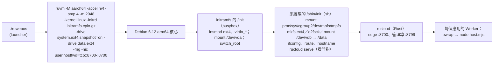
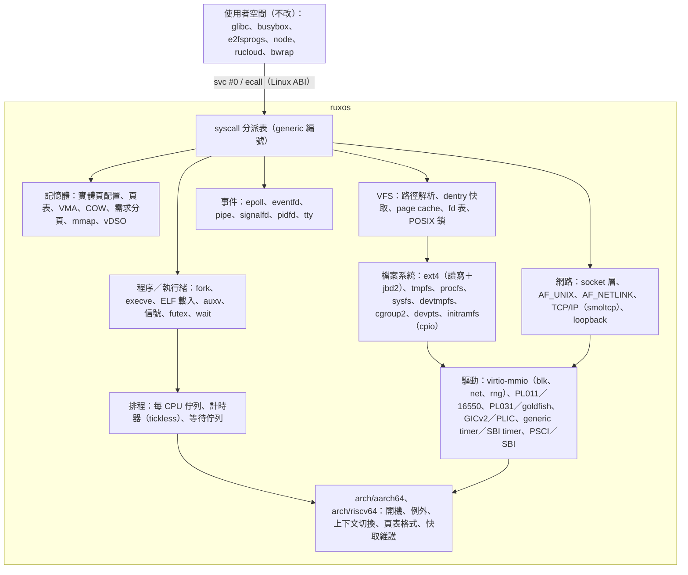
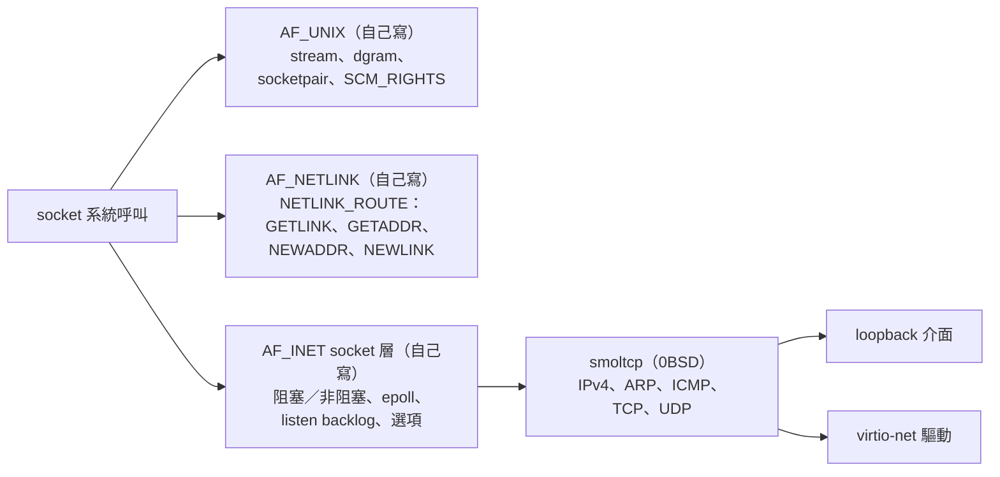

# ruxos 計畫

2026-11-25。ruxos 是用 Rust 寫的作業系統核心，跑在 AArch64 與 RISC-V（riscv64）上。目標只有一個：**取代 ruwebos 現在用的 Linux 核心**，讓沒有改過的 Debian 13 使用者空間、Node.js 24、rucloud 與 ruwebos 的應用照常執行。能做到這件事的最小核心就是 ruxos 的範圍；在 iMac M3 上以 ruvm `-accel hvf` 硬體加速執行，效能接近 Linux。

這份文件是動手之前的計畫；[§10](#10-要請你決定的事) 是要請你決定的事。量測的原始資料在 [syscalls.md](syscalls.md)。

## 1. ruwebos 現在需要核心做什麼

### 1.1 開機的路徑



ruvm 的 `virt` 板子（`ruvm/src/machine.rs`，和 QEMU `virt` 同一套位址）：

| | aarch64 | riscv64 |
|---|---|---|
| RAM | `0x4000_0000` 起 | `0x8000_0000` 起 |
| 中斷控制器 | GICv2（`arm,cortex-a15-gic`）：distributor `0x0800_0000`、CPU 介面 `0x0801_0000`，由 ruvm 模擬（hvf 時也是 MMIO 離開虛擬機） | PLIC `0x0c00_0000`、CLINT `0x0200_0000` |
| 計時器 | ARM generic timer，EL1 virtual timer（PPI 27） | SBI `set_timer`（ruvm 內建 SBI）、`rdtime` |
| 主控台 | PL011 `0x0900_0000`（SPI 1） | NS16550A `0x1000_0000`（PLIC 10） |
| RTC | PL031 `0x0901_0000` | goldfish RTC `0x0010_1000` |
| virtio-mmio | `0x0a00_0000 + 0x200·n`（SPI 16+n），**version 2（modern）** | `0x1000_1000 + 0x1000·n`（PLIC 1+n） |
| 多核心、關機 | PSCI 1.0（`hvc`）：`CPU_ON`、`SYSTEM_OFF`、`SYSTEM_RESET` | SBI HSM `hart_start`、SRST；也有 `sifive,test` syscon |
| 分頁 | 4 KB 頁，48 位元虛擬位址（4 層） | **只有 Sv39**（ruvm 沒有 Sv48/57、沒有 V、H 擴充） |
| 載入 | Linux arm64 `Image` 標頭：核心在 RAM + `text_offset`，`x0` = 裝置樹 | Linux RISC-V `Image` 標頭：`a0` = hartid、`a1` = 裝置樹，S-mode 開始 |

virtio 裝置：blk（`VIRTIO_BLK_F_FLUSH`）、net（`F_MAC`、`F_STATUS`，沒有 offload、沒有 `EVENT_IDX`、沒有 mergeable buffers）、rng。沒有 virtio-console、沒有 PCI。

### 1.2 使用者空間用到的核心介面

[syscalls.md](syscalls.md) 是在 arm64 Linux 上用 `strace -f` 量 rucloud 加上所有 Worker、跑完 14 個應用測試的結果：**103 種系統呼叫、55.8 萬次**。前幾名：`openat` 65k、`futex` 56k、`close` 29k、`epoll_pwait` 18k、`readlinkat` 18k、`fcntl` 16k（幾乎都是 SQLite 的 `F_SETLK`）、`mprotect` 15k、`read` 10k、`write` 7.5k、`mmap` 5.8k。重點：

* **時間全部走 vDSO**（`clock_gettime` 0 次）。沒有 vDSO 的核心，每次讀時間都會變成系統呼叫，Node 讀時間很頻繁。
* **執行緒與 futex**：每個 node 有 V8 的平台執行緒與 libuv 的執行緒池；`FUTEX_WAIT/WAKE_PRIVATE`、`FUTEX_WAIT_BITSET|CLOCK_REALTIME`、`set_robust_list`、`rseq`（可回 `ENOSYS`）、`clone3`（回 `ENOSYS` 時 glibc 改用 `clone`）。
* **JIT 記憶體**：V8 要 `PROT_READ|PROT_WRITE|PROT_EXEC` 的頁（一次保留 256 MB），使用者模式自己做 `DC CVAU`／`IC IVAU`（`SCTLR_EL1.UCI`、讀 `CTR_EL0` 的 `UCT`）；RISC-V 是 `fence.i` 加上 `riscv_flush_icache` 系統呼叫。
* **信號**：V8 用 `SIGSEGV`／`SIGBUS` 處理函式做 WebAssembly 越界陷阱，會讀、改 `ucontext` 裡的暫存器，所以信號框架必須和 Linux 的 `rt_sigframe` 一模一樣（arm64 的 `fpsimd_context`、`esr_context`；riscv64 的 `__riscv_d_ext_state`），arm64 的 `rt_sigreturn` 跳板放在 vDSO（`__kernel_rt_sigreturn`）。
* **檔案**：ext4、`pread64`／`pwrite64`、`fsync`（SQLite，要真的 FLUSH 到磁碟）、`MAP_SHARED` 的檔案映射（SQLite 的 `-shm`）、POSIX 記錄鎖（`F_SETLK`／`F_GETLK`）、`statx`、`getdents64`、`renameat`、`symlinkat`、`utimensat`、`fchown`、`fchmod`、`umask`、`statfs`。
* **事件**：`epoll`（含 `EPOLLET`、`EPOLLRDHUP`）、`eventfd2`、`pipe2`、`signalfd4`、`pidfd_open`、`ppoll`；`io_uring` 回 `ENOSYS`（libuv 會退回 epoll）。
* **網路**：`AF_UNIX` stream 與 dgram（rucloud↔Worker 的主要通道）、`socketpair`；`AF_INET` TCP（edge :8700、出口代理）與 UDP（DNS）；`AF_NETLINK`（`NETLINK_ROUTE`：glibc 的 `getifaddrs`、bwrap 開 `lo`）；`setsockopt` 的 `SO_KEEPALIVE`、`SO_REUSEADDR`、`TCP_NODELAY`、`TCP_KEEPIDLE/INTVL/CNT`。
* **程序**：`fork`、`vfork`、`execve`（ELF，動態連結 `ld-linux-aarch64.so.1`）、`wait4`、`kill`、`setsid`、`prctl`（`PR_SET_NAME`、`PR_SET_PDEATHSIG`、`PR_SET_DUMPABLE`、`PR_SET_NO_NEW_PRIVS`）、`prlimit64`、使用者／群組（`setuid`、`setgid`、`setgroups`）。
* **`/proc` 與 `/sys`**：`/proc/self/{maps,exe,fd,cgroup}`、`/proc/{stat,meminfo,cmdline,uptime,filesystems,version}`、`/proc/sys/kernel/hostname`、`/sys/devices/system/cpu/online`、`/sys/class/net/eth0/{address,device/driver}`、`/sys/fs/cgroup/**`。
* **init 與工具**（讀程式，不在 strace 裡）：busybox `mount`／`umount`／`switch_root`（`MS_MOVE`、`chroot`）、`ifconfig`／`route`（`SIOCSIFADDR`、`SIOCSIFNETMASK`、`SIOCSIFFLAGS`、`SIOCADDRT`）、`poweroff -f`（`reboot`）；e2fsprogs 的 `mkfs.ext4`、`e2fsck`、`blkid` 直接讀寫 `/dev/vdb`（區塊裝置檔、`BLKGETSIZE64`、`BLKSSZGET` 等 ioctl）；`insmod`（ruxos 沒有模組：`init_module` 回 `ENOSYS`，和沒有 `CONFIG_MODULES` 的 Linux 一樣）。
* **籠子**（`[isolation] mode = "on"`，[ruwebos/doc/isolation.md](../../ruwebos/doc/isolation.md)）：bwrap 要 user、mount、pid、net、ipc、uts、cgroup namespace（`clone` 帶 `CLONE_NEW*`、`unshare`、uid/gid map）、bind mount 與唯讀 remount、`pivot_root`、`openat2`（`RESOLVE_IN_ROOT|RESOLVE_NO_MAGICLINKS`）、`devpts`、capabilities（`capget`／`capset`、`PR_CAPBSET_DROP`）；rucloud 的 seccomp 過濾（`PR_SET_SECCOMP`，42 條 cBPF 指令）；cgroup v2 的 `memory.max`、`cpu.max`、`pids.max`、`cgroup.procs`。這是整份清單裡最大、最雜的一塊，見 [§2.10](#210-籠子namespaceseccompcgroup)。

### 1.3 Linux 的基準（這台 iMac M3，ruvm `-accel hvf -smp 4 -m 2048`）

`./ruwebos --test`，2026-11-25：

| 項目 | Linux 6.12（Debian） |
|---|---:|
| 啟動到首頁回應（launcher 量的） | 2.82 s |
| 核心開機到 init 印出第一行（`/proc/uptime`） | 0.12 s |
| 到 `RUWEBOS-READY`（`/proc/uptime`） | 0.48 s |
| 14 個應用測試（各自時間加總） | 9.3 s（installer 4.7 s、weather 1.3 s、files 0.7 s…） |
| 整個 `./ruwebos --test` | 13.45 s |

2.82 s 裡核心之前的部分（ruvm 啟動、載入）與 launcher 的輪詢，M0 會先拆開量清楚。

## 2. 架構

### 2.1 原則

* **Linux 系統呼叫 ABI 相容**：arm64 與 riscv64 用同一張 generic 系統呼叫表（`asm-generic/unistd.h`），呼叫號碼、結構的排列、錯誤碼、`auxv`、信號框架、vDSO 的符號都照 Linux，所以 Debian 的 glibc、busybox、Node、rucloud **不用重新編譯**。沒實作的系統呼叫回 `ENOSYS`，沒實作的選項回 `EINVAL`，和沒開對應 `CONFIG_` 的 Linux 一樣。不看程式名稱、不為特定程式開後門。
* **只做 ruwebos 用到的**：清單來自 [syscalls.md](syscalls.md) 與 §1.2；每加一個系統呼叫都要有一個用到它的程式與一個測試。
* **單體核心（monolithic）**：一個位址空間、一個 Rust 二進位檔，驅動程式在核心裡。微核心的訊息往返在 hvf 下沒有好處，只會比 Linux 慢。
* **SMP 從第一天就有**：每個 CPU 自己的排程佇列，沒有大鎖（BKL）。核心不可搶占（只在回到使用者模式、睡眠時切換），簡化鎖的規則。
* **依賴少，授權列得出來**：`tools/licenses.sh` 從 `cargo tree` 列出每個 crate 的授權（和 rucloud、ruwebos 一樣），寫進 `doc/licenses.md`。

### 2.2 模組



原始碼的位置（一個 cargo workspace）：

| 路徑 | 內容 |
|---|---|
| `kernel/` | 核心（`no_std`），`src/arch/{aarch64,riscv64}/` 是兩個架構各自的部分，其他共用 |
| `vdso/` | vDSO（自己的小 ELF 共享物件，編進核心） |
| `tests/` | 在虛擬機裡跑的測試程式（Linux 使用者程式，見 [§7](#7-測試)） |
| `tools/` | `run.sh`（在 ruvm 裡開機）、`bench.sh`、`licenses.sh` |
| `doc/` | 文件 |

目標三元組：`aarch64-unknown-none`、`riscv64gc-unknown-none-elf`；輸出 `out/<arch>/ruxos`（帶 Linux `Image` 標頭的平坦二進位檔），所以 ruvm、QEMU、U-Boot 都能用 `-kernel` 直接開機。

### 2.3 開機

1. `Image` 標頭進入點：關 MMU 的狀態下建開機頁表，打開 MMU，跳到高位址（核心在 `0xffff_8000_0000_0000` 之上；riscv64 Sv39 在 `0xffff_ffc0_0000_0000` 之上）。arm64 若從 EL2 進來（QEMU 的某些設定），照 Linux 的做法降到 EL1。
2. 解析裝置樹（自己寫的 FDT 讀取器，約 300 行，不需要外部 crate）：記憶體、`/chosen` 的 `bootargs` 與 `linux,initrd-start/end`、各裝置的 `reg`、`interrupts`、`compatible`。
3. 實體記憶體配置器、核心堆積、每 CPU 資料；GIC／PLIC；計時器；用 PSCI `CPU_ON`／SBI HSM 叫醒其他 CPU。
4. 根檔案系統，照 Linux 的核心命令列語意：
   * 有 initramfs：解開 cpio（newc）到 tmpfs，執行 `rdinit=`（預設 `/init`）；
   * 沒有：掛 `root=`（`/dev/vda`，`rootfstype=ext4`，`ro`／`rw`），執行 `init=`（預設 `/sbin/init`）。
5. `console=ttyAMA0`／`ttyS0` 決定 `/dev/console`。`quiet` 時不印核心訊息。

### 2.4 記憶體

* 實體頁：buddy 配置器（4 KB～2 MB），加上每 CPU 的小快取；核心物件用 slab 式的固定大小配置器。
* 核心把所有 RAM 線性映射（2 GB 用 1 GB／2 MB 大頁），驅動程式直接用實體位址做 DMA。
* 每個程序：頁表 + 排序好的 VMA 樹。需求分頁、`fork` 的寫時複製、檔案映射從 page cache 取頁（`MAP_SHARED` 寫回檔案、`MAP_PRIVATE` 寫時複製）、`MAP_NORESERVE`（不預先保留，記憶體真的不夠時給 `SIGBUS`／OOM 殺程序）、`mremap`、`madvise(DONTNEED)`、`mprotect` 可給 RWX。
* arm64：ASID（16 位元）避免每次切換都清 TLB；`TLBI ...IS` 廣播；EL0 可讀 `CNTVCT_EL0`（vDSO 讀時間）與做快取維護。riscv64：ASID 與 `sfence.vma`、SBI 的遠端 `sfence`（IPI）。
* vDSO：`__kernel_clock_gettime`、`__kernel_gettimeofday`、`__kernel_clock_getres`、`__kernel_rt_sigreturn`（arm64；riscv64 是 `__vdso_*` 與 `__vdso_rt_sigreturn`），帶 `LINUX_2.6.39`（riscv64 `LINUX_4.15`）版本符號，glibc 用名稱加版本找。時間資料頁由核心更新（seqlock）。不提供 `vgetrandom`，glibc 就用 `getrandom` 系統呼叫。
* `auxv`：`AT_PHDR`、`AT_PHENT`、`AT_PHNUM`、`AT_PAGESZ`、`AT_BASE`、`AT_ENTRY`、`AT_UID`…、`AT_SECURE`、`AT_RANDOM`、`AT_HWCAP`／`AT_HWCAP2`（照 CPU 的 ID 暫存器算，V8 與 glibc 據此選指令）、`AT_SYSINFO_EHDR`、`AT_MINSIGSTKSZ`、`AT_EXECFN`、`AT_PLATFORM`。arm64 的使用者模式若讀 ID 暫存器（`MRS ID_AA64*`），照 Linux 的 `HWCAP_CPUID` 規則模擬。

### 2.5 程序、執行緒、排程

* 一個 `Task` 是一個執行緒；`clone` 的旗標決定共用哪些東西（`mm`、fd 表、`fs`、信號處理表、執行緒群組）。`CLONE_SETTLS`（`TPIDR_EL0`／`tp`）、`CLONE_CHILD_CLEARTID` + futex 喚醒、`set_robust_list`（結束時處理）、`CLONE_VFORK`。
* 排程：每 CPU 一個佇列，閒置的 CPU 去別的佇列偷工作；固定時間片（例如 4 ms）的循環排程，加上「剛被喚醒的優先」。沒有優先權等級與 CFS（`nice` 接受但不影響，`sched_getscheduler` 回 `SCHED_OTHER`）。閒置時 `WFI`，計時器是 tickless（只在有到期時間時設定），減少離開虛擬機的次數。
* futex：以（`mm`, 位址）雜湊到 256 個桶，每桶自己的鎖；`FUTEX_WAIT`、`WAKE`、`WAIT_BITSET`、`WAKE_BITSET`、`REQUEUE`／`CMP_REQUEUE`、`CLOCK_REALTIME` 逾時。
* 信號：`rt_sigaction`、`rt_sigprocmask`、`sigaltstack`、`rt_sigreturn`、`kill`、`tgkill`、`tkill`、`rt_sigtimedwait`、`signalfd`；系統呼叫被信號打斷時照 Linux 的 `SA_RESTART`／`ERESTARTSYS` 規則；同步例外（頁錯誤、未定義指令、對齊）轉成 `SIGSEGV`／`SIGBUS`／`SIGILL` 並填 `siginfo`（`si_addr`、`si_code`）。
* 認證：uid/gid（real/effective/saved/fs）、補充群組、檔案權限檢查（DAC）。capabilities 先只有「root 全部有、其他沒有」，籠子的階段再補完整的五組集合。
* `execve`：ELF64（`ET_EXEC`、`ET_DYN`、`PT_INTERP`、`PT_GNU_STACK`）、`#!` 腳本；`O_CLOEXEC`；`/proc/self/exe`。

### 2.6 檔案系統

* **VFS**：路徑解析（`..`、符號連結、掛載點、`AT_FDCWD`、`AT_EMPTY_PATH`、`AT_SYMLINK_NOFOLLOW`、`openat2` 的 `RESOLVE_*`）、dentry 快取（含不存在的負快取：`openat` 有 3600 次 `ENOENT`）、統一的 page cache（`read`/`write`/`mmap` 都用同一份）、預讀、背景寫回、`fsync`／`fdatasync`／`sync`。
* **ext4**：自己照 ext4 的公開格式寫（見 [§10 第 1 題](#10-要請你決定的事)）。要支援 ruwebos 的兩個磁碟實際開的功能：`extents`、`64bit`、`flex_bg`、`dir_index`（htree）、`filetype`、`extra_isize`、`huge_file`、`dir_nlink`、`metadata_csum`（crc32c）、`sparse_super`、`large_file`，以及 **jbd2 日誌**（只記中繼資料的 ordered 模式，與 Linux 預設相同；掛載時重播、`fsync` 時提交）。`mkfs.ext4` 新版預設的 `orphan_file` 與 `metadata_csum_seed` 也要認得。不認得的 `incompat` 功能就拒絕掛載（ext4 規範的要求）。
* tmpfs、devtmpfs（`/dev/{null,zero,full,random,urandom,tty,console,vda,vdb,ptmx}`）、procfs、sysfs（只有 §1.2 用到的檔案）、cgroup2、devpts、initramfs 的 cpio。
* 區塊裝置檔：`/dev/vda`、`/dev/vdb` 可以直接讀寫（`mkfs.ext4`、`e2fsck`、`blkid`），和掛載共用同一份區塊快取；`BLKGETSIZE64`、`BLKSSZGET`、`BLKFLSBUF` 等 ioctl。

### 2.7 網路



* TCP/IP 用 **smoltcp**（0BSD 授權，`no_std`，社群裡維護得很好），socket 語意（`accept` 佇列、`SO_ERROR`、`EINPROGRESS`、`SHUT_WR`、`TCP_NODELAY` 等）自己包在它外面。理由：TCP 的正確性細節很多，自己寫的風險大；smoltcp 的弱點是單一介面一把鎖、沒有 offload，但 ruwebos 的流量是本機的 Unix socket 與 ruvm 使用者模式網路（主機↔虛擬機的速度上限在 ruvm），瓶頸不在 TCP。若效能量出來不夠，再把熱路徑換成自己的實作（[§9](#9-風險)）。
* IPv6：ruvm 的使用者模式網路只有 IPv4，先不做（`socket(AF_INET6)` 回 `EAFNOSUPPORT`，Node 與 glibc 都會退回 IPv4）。
* `ifconfig`／`route` 的 ioctl、`/sys/class/net`、netlink 的路由訊息，讓 init 照原樣設定網路。

### 2.8 驅動程式

| 驅動 | aarch64 | riscv64 | 說明 |
|---|---|---|---|
| virtio-mmio（v2，modern）傳輸層 | ✓ | ✓ | split virtqueue；有 `VIRTIO_F_EVENT_IDX` 時就用 |
| virtio-blk | ✓ | ✓ | 多個請求同時在佇列裡、`FLUSH`；直接 DMA 到 page cache 的頁 |
| virtio-net | ✓ | ✓ | 預先放好接收緩衝；中斷後在軟中斷（底半部）收包 |
| virtio-rng | ✓ | ✓ | 餵 `getrandom` 的 ChaCha20 產生器（開機時與定期重新播種） |
| 主控台 | PL011 | NS16550A | 中斷式收、tty 行規（`ICANON`、`ECHO`，init 用 `read` 讀指令）、`TCGETS`／`TCSETS`／`TIOCGWINSZ` |
| RTC | PL031 | goldfish | 開機時設 `CLOCK_REALTIME` |
| 中斷控制器 | GICv2（SGI 當 IPI） | PLIC + SBI IPI | |
| 計時器 | EL1 virtual timer（`CNTV_*`） | SBI `set_timer`、`rdtime` | `CLOCK_MONOTONIC` 直接是計數器 |
| 電源、多核心 | PSCI（`hvc`／`smc`，照裝置樹的 `method`） | SBI HSM、SRST | `reboot(POWER_OFF)` → `SYSTEM_OFF` |

### 2.9 系統呼叫的最小集合

分組列出（arm64 與 riscv64 共用的 generic 編號）。★ 是 [syscalls.md](syscalls.md) 量到的，☆ 是 init、busybox、e2fsprogs、glibc 啟動或退路需要的，◇ 是籠子階段才做的。

| 類別 | 系統呼叫 |
|---|---|
| 檔案 | ★`openat` ★`close` ★`read` ★`write` ★`readv`☆ ★`writev` ★`pread64` ★`pwrite64` ★`lseek` ★`newfstatat` ★`fstat` ★`statx` ★`readlinkat` ★`faccessat` ★`faccessat2` ★`getdents64` ★`mkdirat` ★`unlinkat` ★`renameat`（☆`renameat2`） ★`symlinkat` ☆`linkat` ★`fchmod` ☆`fchmodat` ★`fchown` ★`fchownat` ★`utimensat` ★`ftruncate` ☆`truncate` ★`fsync` ☆`fdatasync` ☆`sync` ★`statfs` ☆`fstatfs` ★`fcntl` ★`dup3` ☆`dup` ★`ioctl` ★`umask` ★`chdir` ★`fchdir` ★`getcwd` ☆`fadvise64` ☆`fallocate` ☆`copy_file_range`（`ENOSYS` 也可以）☆`sendfile` |
| 記憶體 | ★`mmap` ★`munmap` ★`mprotect` ★`madvise` ★`brk` ☆`mremap` ☆`msync` ☆`membarrier` ☆`riscv_flush_icache`（riscv64） |
| 程序、執行緒 | ★`clone` ★`clone3`（回 `ENOSYS`） ★`execve` ★`exit` ★`exit_group` ★`wait4` ☆`waitid` ★`set_tid_address` ★`set_robust_list` ★`rseq`（回 `ENOSYS`） ★`gettid` ★`getpid` ☆`getppid` ★`setsid` ☆`setpgid` ☆`getpgid` ★`prctl` ★`prlimit64` ★`sched_yield` ★`sched_getaffinity` ★`sched_getscheduler` ★`sched_getparam` ★`uname` ☆`sysinfo` ☆`getrusage` ☆`times` ★`getrandom` ☆`reboot` ☆`init_module`（回 `ENOSYS`） |
| 使用者 | ★`getuid` ★`geteuid` ★`getgid` ★`getegid` ★`setuid` ★`setgid` ★`setgroups` ☆`getgroups` ☆`setresuid` ☆`setresgid` ☆`getresuid` ☆`getresgid` ★`capget` ★`capset` |
| 時間 | ☆`clock_gettime` ☆`clock_getres` ☆`gettimeofday`（平常走 vDSO） ☆`clock_nanosleep` ☆`nanosleep` ☆`timerfd_*`（Node 沒用到就不做） |
| 同步 | ★`futex` |
| 信號 | ★`rt_sigaction` ★`rt_sigprocmask` ★`sigaltstack` ☆`rt_sigreturn` ★`kill` ☆`tgkill` ☆`tkill` ☆`rt_sigtimedwait` ☆`rt_sigsuspend` ★`restart_syscall` ★`signalfd4` |
| 事件 | ★`epoll_create1` ★`epoll_ctl` ★`epoll_pwait` ☆`epoll_pwait2` ★`ppoll` ☆`pselect6` ★`eventfd2` ★`pipe2` ★`pidfd_open` ☆`pidfd_send_signal` ★`io_uring_setup`（回 `ENOSYS`） |
| 網路 | ★`socket` ★`socketpair` ★`bind` ★`listen` ★`accept4` ★`connect` ★`getsockname` ☆`getpeername` ★`getsockopt` ★`setsockopt` ★`sendto` ★`recvfrom` ☆`sendmsg` ★`recvmsg` ★`sendmmsg` ☆`recvmmsg` ★`shutdown` |
| 掛載 | ★`mount`（一般掛載與 `MS_MOVE`） ★`umount2` ☆`chroot` ☆`sethostname`（也可經 `/proc/sys/kernel/hostname`） |
| 籠子 ◇ | ★`unshare` ★`pivot_root` ★`openat2` ★`sethostname`（在 UTS namespace 裡） `clone` 的 `CLONE_NEW*`、`setns`、seccomp（`prctl` 與 `seccomp`）、capabilities 的完整語意 |

合計約 140 個。Linux arm64 有 300 多個。

`uname` 回 `sysname = "Linux"`（ABI 是 Linux 的；glibc、Node 與其他「相容 Linux ABI 的核心」都這麼做，例如 gVisor），`release` 回 `6.12.0-ruxos-<版本>`（表示對應的 Linux ABI 層級），`version` 寫 `ruxos <版本>`。設定應用顯示的「核心」會是這個字串。

### 2.10 籠子（namespace、seccomp、cgroup）

這一塊放在後面的里程碑（[§10 第 2 題](#10-要請你決定的事)），因為它不影響「跑得起來」，但量最大：

| 項目 | ruxos 的做法 |
|---|---|
| user namespace | uid/gid map（`/proc/<pid>/uid_map`、`gid_map`、`setgroups`），namespace 裡的 capabilities |
| mount namespace | 每個 namespace 自己的掛載樹（複製）、bind mount、`MS_REC`、唯讀 remount、`MS_PRIVATE`（只做 private，不做 shared/slave 的傳播）、`pivot_root`、`umount2(MNT_DETACH)` |
| pid namespace | 每個程序在每層 namespace 的 pid；`/proc` 依掛載它的 namespace 顯示 |
| net namespace | 每個 namespace 自己的 smoltcp 介面組（新的只有 `lo`），AF_UNIX 的抽象位址也分開 |
| ipc、uts、cgroup namespace | uts：hostname；ipc：ruwebos 沒用到 System V IPC，只要有 namespace 物件；cgroup：`/proc/self/cgroup` 的根 |
| seccomp | `SECCOMP_MODE_FILTER` 的 classic BPF 直譯器（指令集很小）、`SECCOMP_RET_ERRNO`／`KILL`／`ALLOW`、`no_new_privs` |
| cgroup v2 | `cgroup.procs`、`cgroup.subtree_control`、`memory.max`（配置頁時檢查）、`pids.max`（`fork` 時檢查）、`cpu.max`（排程器的頻寬限制） |

## 3. 效能

### 3.1 為什麼可以接近 Linux

在 hvf 裡，使用者程式與核心的指令都直接在 M3 上跑，兩個核心的差別只在：系統呼叫路徑的長短、鎖、記憶體管理的策略（頁錯誤次數、TLB）、page cache 與 I/O 的批次化、以及**離開虛擬機的次數**（MMIO：virtio 的通知、GIC 的 ack/EOI；`WFI`；計時器）。ruxos 的功能少很多，系統呼叫路徑可以比 Linux 短；要小心的是 TCP（smoltcp）、ext4 的寫入與日誌、SMP 的鎖。

設計上的對策：tickless 計時器；中斷的 ack/EOI 一次處理多個；virtio 的通知盡量合併（有 `EVENT_IDX` 時用）；page cache 預讀與背景寫回；dentry 的負快取；futex 與 POSIX 鎖用雜湊桶；每 CPU 的頁配置快取；`MAP_PRIVATE` 的程式庫映射直接共用 page cache 的頁。

### 3.2 目標（同一台 iMac M3、同樣的 ruvm 參數、同樣的磁碟）

| 指標 | Linux 6.12 | ruxos 的目標 |
|---|---:|---|
| 核心自己的開機時間（進入點到執行 init） | ~0.1 s | ≤ 0.05 s |
| 啟動到首頁回應（launcher） | 2.82 s | ≤ Linux |
| 14 個應用測試的時間加總 | 9.3 s | ≤ 1.1 × Linux |
| 請求延遲（`tools/bench.sh`：首頁、一個靜態檔、一個 D1 查詢，各 1000 次，p50／p99） | M0 量 | ≤ 1.1 × Linux |
| 吞吐量（同上，10 個並行連線） | M0 量 | ≥ 0.8 × Linux |
| 開機後的記憶體用量（`/proc/meminfo` 的 MemTotal − MemAvailable） | M0 量 | ≤ Linux |

`tools/bench.sh` 在 M0 寫好，對 Linux 與 ruxos 各跑一次，結果寫進 `doc/bench.md`。

## 4. ruwebos 怎麼換核心

launcher 加一個選項，磁碟完全不換：

```sh
./ruwebos --kernel ruxos          # 預設 --kernel linux（現在的樣子）
./ruwebos --kernel ruxos --qemu   # QEMU virt 也可以（同一個 Image）
```

| | `--kernel linux`（現在） | `--kernel ruxos` |
|---|---|---|
| 核心檔 | `../ruvm/tests/guest/out/linux/debian/arm64/linux` | `../ruxos/out/aarch64/ruxos`（或 `RUXOS=` 指定的 checkout，沒有就先建） |
| initramfs | ruvm 的（載入模組、`switch_root`） | 不用：ruxos 沒有模組，直接用 `root=` |
| 命令列 | `console=ttyAMA0 rdinit=/init quiet ruwebos.tz=…` | `console=ttyAMA0 root=/dev/vda rootfstype=ext4 rw init=/sbin/init quiet ruwebos.tz=…` |
| 磁碟、網路、加速 | 相同 | 相同 |

這些都是 Linux 標準的命令列參數，所以 `--kernel ruxos` 的命令列拿去開 Linux（有內建 ext4 與 virtio 驅動的核心）也一樣能開機。

ruwebos 那邊要改的（各自在 ruwebos 的 commit）：launcher 的 `--kernel`（shell 版與 `cargo install ruwebos` 的 Rust 版）、README 架構圖的「可替換」標記加上核心、`doc/` 的說明；如果採用 [§10 第 2 題](#10-要請你決定的事) 的分階段，init 再加一個 `ruwebos.isolation=` 命令列參數。ruvm 原則上不用改；若加 `VIRTIO_F_EVENT_IDX` 等功能，兩個核心都受益，會是 ruvm 自己的 commit。

## 5. 里程碑

每個里程碑都在 ruvm `-accel hvf`（aarch64）與 ruvm TCG（riscv64）上驗證，同一批測試也在 Linux 上跑一次當對照。每個里程碑一個（或幾個）commit，你 push。

| | 內容 | 完成的標準 |
|---|---|---|
| **M0 骨架** | workspace、兩個架構的 `Image` 標頭與進入點、FDT、主控台、PSCI/SBI 關機；`tools/run.sh`、`tools/bench.sh`（先量 Linux 的基準）、`tools/licenses.sh` | `ruvm -accel hvf -kernel out/aarch64/ruxos` 印出裝置樹摘要後關機；riscv64 同樣；`doc/bench.md` 有 Linux 的數字 |
| **M1 核心機制** | 實體頁、頁表、核心堆積、例外、GIC/PLIC、計時器、SMP（4 CPU）、核心執行緒與排程、等待佇列、自我測試 | 4 個 CPU 互相丟工作的自我測試在 hvf 與 TCG 都過 |
| **M2 使用者程式** | ELF 載入、系統呼叫分派、`fork`/`execve`/`wait4`/`exit`、`mmap`/`brk`/COW、futex、信號（Linux 相同的框架）、vDSO、initramfs（cpio→tmpfs）、tty | ruvm 的 initramfs（`rdinit=/init`）跑到 busybox 的 shell（`insmod` 失敗但繼續）；`tests/` 的 ABI 測試（執行緒、futex、信號、mmap）在兩個核心結果相同 |
| **M3 讀 ext4、跑 Node** | virtio-blk、區塊快取、page cache、VFS、ext4 唯讀、devtmpfs、procfs、sysfs、`root=` 開機、動態連結的 glibc 程式、epoll、eventfd、pipe、AF_UNIX | 系統碟唯讀掛成根目錄、`/tmp` 在 tmpfs：`node -e` 跑 JIT 與 WebAssembly 測試、`node:worker_threads`、`child_process` |
| **M4 寫 ext4** | ext4 寫入（配置、extents、htree、rename、truncate、symlink）、jbd2 日誌（提交、重播）、`metadata_csum`、`fsync`、POSIX 鎖、`MAP_SHARED` 寫回、區塊裝置檔 | 在 ruxos 上 `mkfs.ext4`、寫一大堆檔案、SQLite 測試、硬關機後重開能重播；在 Linux 上 `e2fsck -fn` 全部乾淨 |
| **M5 網路** | virtio-net、smoltcp、AF_INET TCP/UDP socket 層、loopback、AF_NETLINK（route）、`ifconfig`/`route` 的 ioctl、`/sys/class/net` | 虛擬機裡 `node` 的 HTTP 伺服器經 ruvm 的 port forward 被主機連到；從虛擬機 `fetch` 網際網路（DNS 走 10.0.2.3） |
| **M6 ruwebos 開機** | 補齊 init、rucloud、Worker 用到的其他東西；ruwebos 的 launcher 加 `--kernel ruxos`（ruwebos 的 commit）；籠子先用 `auto`（看第 2 題） | `./ruwebos --kernel ruxos --test`：**14/14 通過**（hvf） |
| **M7 效能** | 量 `tools/bench.sh`、找熱點（ruxos 自己的計數器：系統呼叫、頁錯誤、離開虛擬機的原因），調到 §3.2 的目標 | `doc/bench.md` 的 ruxos 欄達到目標 |
| **M8 籠子** | §2.10：namespace、seccomp、cgroup v2、`openat2`、`pivot_root`、devpts | `mode = "on"` 下 14/14 通過，包括 installer 測試裡「關在籠子裡的應用連得到網際網路」那一項 |
| **M9 riscv64 上的 ruwebos** | 看第 3 題 | 看第 3 題 |

RISC-V 不是最後才做：M0～M5 每一步都在 ruvm 的 riscv64（TCG）上跑同一批測試，用 ruvm 的 Debian riscv64 根檔案系統（`tests/guest/out/linux/root/riscv64/root.ext4`）。

```mermaid
gantt
  dateFormat X
  axisFormat %s
  section 核心
  M0 骨架            :m0, 0, 1
  M1 核心機制         :m1, after m0, 2
  M2 使用者程式       :m2, after m1, 3
  section 檔案與網路
  M3 讀 ext4、Node    :m3, after m2, 3
  M4 寫 ext4         :m4, after m3, 3
  M5 網路            :m5, after m3, 2
  section ruwebos
  M6 14 個測試        :m6, after m4, 2
  M7 效能            :m7, after m6, 2
  M8 籠子            :m8, after m7, 3
```



（相對工作量，不是日期。）

## 6. 依賴與授權

| 依賴 | 授權 | 用途 |
|---|---|---|
| `smoltcp` | 0BSD | TCP/IP |
| `bitflags` | MIT OR Apache-2.0 | 旗標型別（smoltcp 也用） |
| `byteorder`、`managed`、`heapless` 等 smoltcp 的相依 | MIT OR Apache-2.0 | |

其他（FDT 讀取、ext4、配置器、virtio、vDSO、crc32c、ChaCha20）自己寫，不用外部 crate。`tools/licenses.sh` 從 `cargo tree` 產生 `doc/licenses.md`，CI（`./test.sh`）檢查表格與 `Cargo.lock` 一致。測試時用到的外部程式（strace、e2fsprogs、LTP 等）不編進 ruxos，不算依賴。

## 7. 測試

* **差分測試**：`tests/` 裡是普通的 Linux 使用者程式（C 用 `zig cc` 交叉編譯成 aarch64/riscv64 的 glibc 動態連結程式，或 Rust std 程式），每個測一組系統呼叫的語意（錯誤碼、邊界、併發）。同一個程式在 Linux（ruvm 裡的 Debian 核心）與 ruxos 上跑，輸出必須相同。不比對「跟 Linux 一模一樣的時間或位址」，只比對語意。
* **Node 測試**：一組 `node` 腳本（JIT、WebAssembly 的越界陷阱、`worker_threads`、`child_process`、`fs`、`net`、`http`、`crypto`、`zlib`、SQLite 透過 rucloud）。
* **ext4**：每次寫入測試後在 Linux 上 `e2fsck -fn`；斷電測試（ruvm 直接殺掉後重開，日誌要能重播）。
* **ruwebos**：`./ruwebos --kernel ruxos --test`（14 個應用），`tools/bench.sh`。
* `./test.sh`：建置兩個架構、跑以上能自動跑的部分（hvf 與 TCG）。

## 8. 不做的事

模組載入、PCI、ACPI、x86、IPv6、System V IPC、`io_uring`、`ptrace`、`perf`、BPF（除了 seccomp 的 cBPF）、SELinux 等 LSM、swap、NUMA、熱插拔、休眠、檔案系統的配額、ext4 以外的磁碟格式、圖形與輸入裝置。使用者程式用到時回 `ENOSYS`／`EINVAL`／`EOPNOTSUPP`，與沒開對應功能的 Linux 一致。

## 9. 風險

| 風險 | 影響 | 對策 |
|---|---|---|
| ext4 寫壞資料碟 | 使用者資料遺失 | M4 之前資料碟只能唯讀掛載（寫入放在 tmpfs、明確警告）；每個寫入測試後用 Linux 的 `e2fsck` 檢查；斷電測試；第一次用 ruxos 開機前 launcher 備份資料碟（看第 1 題） |
| Node／V8 依賴的細節（信號框架、`HWCAP`、`/proc/self/maps` 的格式、`MAP_NORESERVE` 的大保留、`membarrier`） | Node 起不來或偶發當掉 | M2、M3 的差分測試專測這些；照 Linux 的標頭與文件寫，不猜 |
| smoltcp 的效能或語意（`listen` backlog、半關閉、大量連線） | 請求延遲、測試失敗 | socket 層自己寫、smoltcp 只負責協定；量到瓶頸再換掉 TCP 的熱路徑 |
| SMP 的競爭條件 | 偶發當機 | 每個里程碑的測試都在 4 CPU 下跑多次；鎖的層級寫在文件裡；核心不可搶占 |
| hvf 與 ruvm 的特性（模擬的 GICv2 每次 ack/EOI 都離開虛擬機、沒有 `EVENT_IDX`） | 中斷多時變慢 | 兩個核心付一樣的代價；必要時給 ruvm 加功能（ruvm 自己的 commit） |
| ruvm 的 riscv64 只有 Sv39、沒有 V 擴充、TCG 慢 | Node 在 riscv64 TCG 上很慢 | riscv64 的驗證以正確性為主（見第 3 題），效能目標只對 hvf |
| 籠子（M8）的量很大 | 拖長時程 | 先用 `auto` 達到 14/14（第 2 題），籠子是獨立的一步 |
| 範圍蔓延 | 做不完 | 每個系統呼叫都要有量測或讀程式的依據（§1.2）才加 |

## 10. 要請你決定的事

**決定（2026-11-25）：五項都照建議。** ext4 完整讀寫加 jbd2；籠子分兩步（M6 用 `auto`，M8 改回 `on`）；RISC-V 驗證到 M5、不做 riscv64 系統碟（沒有 M9）；`--kernel ruxos` 用 `root=` 直接開機；MIT 授權。

1. **資料碟的 ext4**：
   * **(建議) 完整的 ext4 讀寫加 jbd2 日誌**，磁碟格式不變，Linux 與 ruxos 可以輪流開同一個資料碟。工作量最大的一塊（M4）。
   * 或：ruwebos 的 init 改用沒有日誌的 ext4 格式化資料碟（`mkfs.ext4 -O ^has_journal`），ruxos 只寫沒有日誌的 ext4。省下 jbd2，但當機後要靠 `e2fsck`，且現有的資料碟要轉換。
2. **籠子**（`[isolation] mode = "on"`）：
   * **(建議) 分兩步**：M6 先在 ruxos 上用 `auto`（ruwebos 的 init 認得 `ruwebos.isolation=auto` 這個命令列參數，launcher 在 `--kernel ruxos` 時傳；rucloud 的 `auto` 本來就是「能用就用，不能用就警告後繼續」），達到 14/14；M8 再做 namespace、seccomp、cgroup，改回 `on`。
   * 或：M6 之前就做完籠子，ruxos 從一開始就用 `on`（時程拉長，但不會有一段「ruxos 上的應用沒關籠子」的期間）。
   * 或：ruxos 永遠不做籠子（ruxos 上的 ruwebos 只有 Node 那一層的沙箱）。
3. **RISC-V 的範圍**：
   * **(建議)** M0～M5 都在 ruvm 的 riscv64（TCG）上驗證，用 ruvm 現有的 Debian riscv64 根檔案系統，跑 busybox、差分測試、ext4、網路與 `node`（Node 24 的 riscv64 版只有 unofficial-builds）；**不做** riscv64 的 ruwebos 系統碟。
   * 或：再加 M9，ruwebos 的 `image/build.sh` 產生 riscv64 的系統碟（rucloud 交叉編譯成 `riscv64gc-unknown-linux-gnu`、Node 用 unofficial-builds 的 riscv64 版，授權要列入），在 TCG 上跑 14 個測試（會很慢，可能要幾分鐘）。
4. **開機方式**：`--kernel ruxos` 用 `root=/dev/vda` 直接開系統碟、不用 initramfs（**建議**，較快、較簡單），或照現在一樣經過 ruvm 的 initramfs（ruxos 也支援，但 `insmod` 會印一堆失敗訊息）。
5. **授權**：ruxos 用 MIT（和 ruvm、ruwebos 一樣），smoltcp 是 0BSD。可以嗎？
